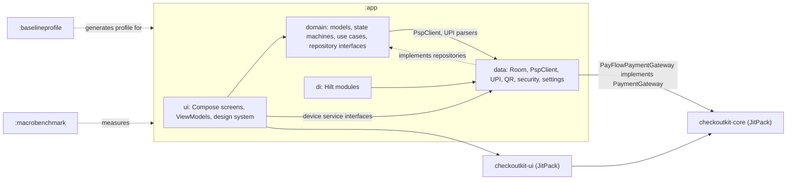
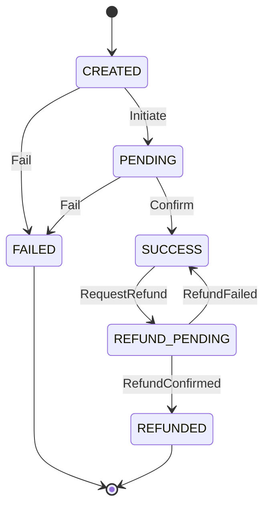
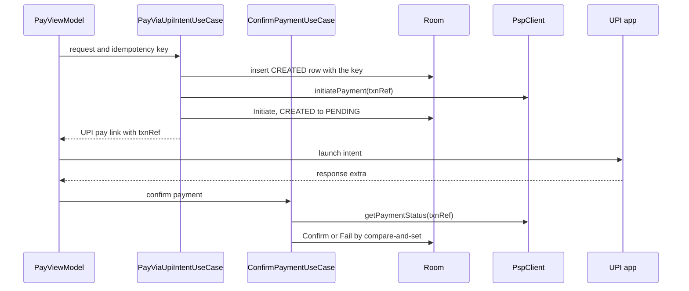

# PayFlow

[](gradle/libs.versions.toml)
[](app/build.gradle.kts)
[](gradle/libs.versions.toml)
[](https://github.com/Darshan-05032003/CheckoutKit)

PayFlow is an Android UPI payments app built with Kotlin, Jetpack Compose, Hilt and Room. It pays through the UPI apps
installed on the phone or against an in-app sandbox payment service provider (PSP). At its core is a payment state machine
that rejects illegal transitions, surrounded by idempotent submits, status reconciliation and a hardened client.

PayFlow has no bank or PSP behind it. In **UPI apps** mode real money moves through the UPI app the user picks, and PayFlow
records what that app reports. In **Sandbox** mode every payment is settled by an in-memory `FakePsp` and no money moves.
See [Real UPI apps vs sandbox](#real-upi-apps-vs-sandbox).

<p align="center">
  
</p>

## Contents

[Features](#features) · [Architecture](#architecture) · [Tech stack](#tech-stack) ·
[Project structure](#project-structure) · [Getting started](#getting-started) ·
[CheckoutKit integration](#checkoutkit-integration) · [Testing](#testing) · [Performance](#performance) ·
[Security](#security) · [Documentation](#documentation) · [Disclaimer](#disclaimer) · [License](#license)

## Features

- **Home and history**: payment feed, search and filters over Room, a detail sheet and a shareable receipt.
- **UPI intent flow**: `upi://pay` links (`pa`, `pn`, `am`, `cu`, `tn`, `tr`), an in-app UPI app picker with a system
  chooser fallback, and defensive parsing of the app's `response` extra.
- **Scan to pay**: CameraX with ML Kit, or a QR from a gallery image through the Photo Picker (zxing fallback).
- **Incoming links and Receive**: handles `upi://pay` links from other apps; renders a Receive QR for the user's UPI ID.
- **UPI ID verification and collect requests**: format checks, a sandbox lookup of the registered payee name, and collect
  requests that can be approved, declined or left to expire.
- **AutoPay mandates**: create, pause, resume and revoke, with frequency and maximum-amount rules.
- **Polling and idempotency**: exponential backoff with full jitter, a single-flight poller, and an idempotency key
  stored in Room before any PSP call.
- **App security**: PIN and biometric lock, Keystore encryption, simulated device binding, root and tamper checks,
  Play Integrity and `FLAG_SECURE`.
- **Merchant checkout**: the [CheckoutKit](https://github.com/Darshan-05032003/CheckoutKit) payment sheet from JitPack.
- **Design system**: token-based Compose components, light and dark themes, reduce motion and a debug-only catalog
  ([`docs/DESIGN_SYSTEM.md`](docs/DESIGN_SYSTEM.md)).

## Architecture

PayFlow is a single-activity Compose app organised as MVVM over `ui`, `domain` and `data` packages in one `:app` module.
ViewModels call use cases and repository interfaces from `domain`; `data` implements those repositories with Room. Use
cases talk to the PSP through the `PspClient` interface, and ViewModels reach device services (app lock, camera, UPI app
launcher) through interfaces in `data`, so they can be replaced by fakes on the JVM. Hilt modules in `di` bind the implementations.
Every ViewModel exposes one `StateFlow<UiState>`; dispatchers and `java.time.Clock` are injected; money is `Long` paise.



### Payment state machine

`PaymentStateMachine` is a pure transition function over `PaymentStatus` and `PaymentEvent`. Every pair not shown below is
rejected and leaves the payment untouched.



`Confirm` and `Fail` carry a `StatusSource` (`PSP`, `UPI_APP` or `USER`) that is persisted and shown in the UI. Transitions
are written with a SQL compare-and-set (`UPDATE ... WHERE id = ? AND status = ?`), so racing writers cannot settle a payment
twice.

### Data flow: a sandbox payment



In UPI apps mode the PSP calls are skipped: the payment moves to `PENDING` before launch, and `RecordUpiAppResultUseCase`
stores the app's answer only if it names PayFlow's `txnRef`.

### Design decisions

- **A pure state machine with compare-and-set writes** instead of status fields set from many places.
- **Idempotency key on the payment row before the PSP call**: double taps, retries and process death return the stored payment.
- **A UPI app's answer is never treated as verification.** In sandbox mode only a PSP status check settles a payment; in UPI
  apps mode the outcome is labelled as reported by the app or marked by the user.
- **A PSP outage leaves a payment pending**, never failed, while the money may have moved.
- **`PspClient` is an interface** with `FakePsp` and an OkHttp `HttpPspClient`, so a real PSP can be added without touching
  the domain layer.

More in [`docs/DECISIONS.md`](docs/DECISIONS.md).

## Tech stack

| Library | Version | Purpose |
|---|---|---|
| Kotlin, kotlinx.coroutines | 2.4.21, 1.11.0 | Language, structured concurrency and Flow |
| Jetpack Compose BOM, Material 3 | 2026.09.00 | UI toolkit |
| Navigation Compose, kotlinx.serialization | 2.10.2, 1.12.0 | Type-safe routes; PSP JSON |
| Hilt (KSP) | 2.60.1 | Dependency injection |
| Room | 2.8.5 | Payments, collect requests and mandates, with schema migrations |
| DataStore Preferences | 1.3.0 | Payment mode and UI settings |
| OkHttp | 5.5.1 | `HttpPspClient` for a REST sandbox PSP |
| CameraX, ML Kit Barcode Scanning | 1.6.2, 17.3.0 | Camera QR scanning |
| zxing core | 3.5.4 | Receive QR generation and gallery decoding fallback |
| AndroidX Biometric, Play Integrity | 1.1.0, 1.6.0 | App lock; device integrity token request |
| CheckoutKit | v1.0.0 | Merchant checkout sheet |
| Macrobenchmark, Baseline Profile | 1.5.0 | Startup and scroll benchmarks, profile generation |

Tests use JUnit 4, Truth, MockK, Turbine, Robolectric 4.17, MockWebServer, Roborazzi 1.78.0 and Kover 0.9.11. LeakCanary
2.14 runs in debug builds only. The build uses AGP 9.5.0 with built-in Kotlin and Gradle 9.6.0.

## Project structure

```text
PayFlow/
├── app/
│   └── src/
│       ├── main/kotlin/com/darshan/payflow/
│       │   ├── core/          Money, backoff policy, dispatchers
│       │   ├── domain/        models, state machines, use cases, repository interfaces
│       │   ├── data/          local (Room), psp, upi, qr, security, checkout, settings, profile
│       │   ├── di/            Hilt modules
│       │   └── ui/            one package per screen, plus designsystem/ and navigation/
│       ├── debug/             Sandbox UPI test app and design-system catalog
│       ├── benchmark/         seed-data receiver for benchmark builds
│       └── test/              unit, integration (Robolectric), stress; screenshots/ holds baselines
├── baselineprofile/           Baseline Profile generator
├── macrobenchmark/            startup and scroll benchmarks
├── scripts/                   token audit and device benchmark scripts
└── docs/                      design notes, reviews and reports
```

## Getting started

### Requirements

- JDK 17 or newer (the build uses a JDK 17 toolchain)
- An Android Studio release that supports AGP 9.5, or the Gradle wrapper on its own
- Android SDK platform 37 (compileSdk and targetSdk 37); the app runs on API 26 and above

### Setup

1. Clone the repository: `git clone https://github.com/Darshan-05032003/PayFlow.git`.
2. Create `local.properties` in the project root. It is gitignored. Only `sdk.dir` is required; the other keys are optional:
   ```properties
   sdk.dir=/path/to/Android/sdk
   # Google Cloud project number for the Play Integrity token request (0 when absent).
   # Token verification needs a server; the app uses FakeIntegrityVerifier and says so in the UI.
   PLAY_INTEGRITY_CLOUD_PROJECT=<your-cloud-project-number>
   # SHA-256 of your signing certificate; when set, a repackaged APK is flagged and blocked from paying
   EXPECTED_SIGNING_SHA256=<your-signing-cert-sha256>
   # https base URL of a REST sandbox PSP; when empty the in-memory FakePsp is used
   PSP_BASE_URL=<https://your-psp-sandbox.example>
   ```
3. Build and install:
   ```bash
   ./gradlew assembleDebug      # debug APK
   ./gradlew installDebug       # installs on every connected device or emulator
   ```

### Real UPI apps vs sandbox

The mode is switched in Me → Security centre → Payment mode, behind the app lock. The default is UPI apps when a UPI app is
installed and Sandbox otherwise, for example on an emulator.

| | UPI apps mode | Sandbox mode |
|---|---|---|
| Who moves the money | The chosen UPI app and the user's bank. **Real money.** | Nobody. `FakePsp` in memory. |
| How the result is decided | The app's `response` extra, accepted only for PayFlow's `txnRef`; otherwise the payment stays pending until the user marks it | A PSP status check matching `txnRef`, amount and payee |
| What the UI says | "Reported by *app*. Not verified by PayFlow." or "Marked by you" | "Confirmed by the sandbox payment provider" |
| Collect, AutoPay, Checkout | Sandbox only | Sandbox |

> **Safety note.** In UPI apps mode PayFlow has nothing independent to confirm a payment against: the UPI app's answer, or
> the user's own mark, is the stored outcome. The mitigations are structural (pinned app package, `txnRef` match, idempotency,
> pending by default, status source stored and shown), not cryptographic. If you try it with real money, send ₹1 to your
> own UPI ID.

Debug builds include **Sandbox UPI (debug)**, a stand-in UPI app (debug manifest only) that answers with success, failure,
pending, cancel or another `txnRef`, so the UPI apps flow can be exercised on an emulator.

## CheckoutKit integration

PayFlow consumes [CheckoutKit](https://github.com/Darshan-05032003/CheckoutKit) from JitPack. Use the module coordinate,
not JitPack's aggregate `com.github.Darshan-05032003:CheckoutKit`, which pulls the JVM variant of the core and causes
duplicate classes in an Android app.

```kotlin
// settings.gradle.kts, inside dependencyResolutionManagement.repositories
maven("https://jitpack.io")

// app/build.gradle.kts
implementation("com.github.Darshan-05032003.CheckoutKit:checkoutkit-ui:v1.0.0")
```

- `PayFlowPaymentGateway` implements the SDK's `PaymentGateway` (charge, status, refund) on top of PayFlow's `PspClient`,
  so checkout payments share the sandbox, the history and the reconciler with every other payment.
- `CheckoutModule` provides one `CheckoutKit` with its retry and pending-poll policies; the Checkout screen hosts the sheet
  with `rememberCheckoutSheet`.
- `RecordCheckoutResultUseCase` stores each `CheckoutResult` as a `CHECKOUT` payment. An `Unresolved` result is kept
  pending under the PSP order reference and reconciled later; a cancelled sheet records nothing.

Integration notes and feedback on the SDK's API are in [`docs/DECISIONS.md`](docs/DECISIONS.md).

## Testing

All tests run on the JVM, mostly against hand-written fakes (`FakePsp`, `InMemoryCryptoBox`, a fake `UpiAppLauncher`)
rather than mocks. Room, Compose screens and Hilt wiring run under Robolectric, `HttpPspClient` against MockWebServer, and
Flows with Turbine on virtual time. Roborazzi screenshot tests cover design-system components and screen states in both
themes and at 1.3× font scale. A stress suite fires thousands of concurrent payments, spoofed responses and hostile QRs.

```bash
./gradlew testDebugUnitTest                    # unit and Robolectric integration tests
./gradlew verifyRoborazziDebug                 # same run, comparing screenshots with the committed baselines
./gradlew recordRoborazziDebug --tests '*HomeScreenshotTest*'   # re-record one class after an intended change
./gradlew stressTest                           # load and stress simulations, excluded from the normal run
./gradlew koverLogDebug koverVerifyDebug       # domain + data line coverage, rule >= 80 %
./gradlew lintDebug
python3 scripts/token_audit.py                 # raw colours, dp, sp or durations in screen code
```

Latest run: 1,260 unit and integration tests, 67 stress tests, 202 screenshot baselines; domain and data line coverage
90.7 %. Device-only classes (Keystore, BiometricPrompt, Play Integrity, CameraX) compile and pass lint but are not exercised
on the JVM.

## Performance

- **Baseline Profile**: `:baselineprofile` (`BaselineProfileGenerator`) and `profileinstaller` are set up; no generated
  profile is committed yet.
- **Macrobenchmark**: `:macrobenchmark` measures cold startup and Home and History scrolling on a release-like `benchmark`
  build type, with `None` and `Partial` compilation.
- **Compose stability**: `app/compose_stability.conf` marks `java.time` types stable; unstable composable parameters in the
  release compiler metrics went from 26 to 7 (`./gradlew :app:compileReleaseKotlin -PcomposeReports=true`).

Device numbers after the UI overhaul have not been measured yet. Earlier software-rendered emulator figures and the method
are in [`docs/LOAD_TEST_REPORT.md`](docs/LOAD_TEST_REPORT.md).

## Security

- **Screen and input protection**: `FLAG_SECURE` on payment screens and the lock screen; `filterTouchesWhenObscured` on the
  window to block tapjacking overlays.
- **App lock**: BiometricPrompt, or a 6-digit PIN hashed with PBKDF2-HmacSHA256 (150,000 iterations, random salt);
  5 wrong attempts lock the app for 30 seconds, doubling up to an hour. The app relocks after 60 seconds in the background.
- **Encryption at rest**: the PIN record, device binding and Receive profile are AES-GCM encrypted with an Android Keystore
  key, bound to their key name.
- **Payment integrity**: idempotency keys with a unique index, compare-and-set transitions, and `txnRef`, amount and payee
  checks on every confirmation.
- **Hostile input**: QR payloads and incoming links go through one bounded parser that rejects homoglyph and bidi UPI IDs,
  `javascript:` payloads and out-of-range amounts; the UPI app's `response` extra is size-bounded and parsed defensively.
- **Device checks and hardening**: root and tamper detection and a Play Integrity request gate payments; `allowBackup` is
  off and cleartext traffic is disabled.

Attacks, findings and fixes per feature: [`docs/SECURITY_REVIEW.md`](docs/SECURITY_REVIEW.md).

## Documentation

- [`docs/PLAN.md`](docs/PLAN.md): build plan, package structure, test and stress plan
- [`docs/DECISIONS.md`](docs/DECISIONS.md): design decisions, compromises and CheckoutKit API feedback
- [`docs/SECURITY_REVIEW.md`](docs/SECURITY_REVIEW.md): per-feature threats, findings and fixes
- [`docs/LOAD_TEST_REPORT.md`](docs/LOAD_TEST_REPORT.md): stress scenarios, benchmark method and results
- [`docs/DESIGN_SYSTEM.md`](docs/DESIGN_SYSTEM.md): tokens, components, motion and accessibility rules
- [`docs/DESIGN_DIRECTION.md`](docs/DESIGN_DIRECTION.md): the visual direction and the alternatives considered
- [`docs/UI_AUDIT.md`](docs/UI_AUDIT.md): the audit the UI overhaul started from
- [`docs/CREDITS.md`](docs/CREDITS.md): fonts and licences

Screens and recordings: [`docs/screenshots`](docs/screenshots), [`docs/media`](docs/media).

## Disclaimer

PayFlow is a portfolio project, not a licensed payment service. It is not affiliated with NPCI, any bank or any UPI app.
The sandbox PSP, simulated device-binding OTP and Play Integrity verification are stand-ins for services a real deployment
would need. All names and payments in the sandbox data are invented.

## License

Portfolio project by Darshan Sonawane. All rights reserved unless a license file says otherwise.
Bundled fonts (Newsreader, Geist) are under the SIL Open Font License 1.1; see [`docs/CREDITS.md`](docs/CREDITS.md).
