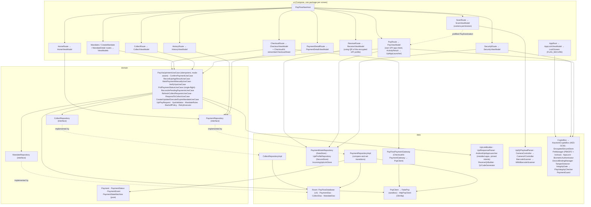

# PayFlow

**A UPI payments app for Android, built the way a payments team would build it: a payment state machine that
cannot be pushed into an illegal state, idempotent submits, a hardened client, and an honest line between what
the app knows and what it is told.**
Pay through the UPI apps installed on the phone (GPay, PhonePe, Paytm, BHIM) or against a realistic
**sandbox PSP**; scan or receive UPI QRs, validate UPI IDs, handle collect requests and AutoPay mandates.

> **Two modes.** *UPI apps* (default on a real phone): PayFlow hands `upi://pay` to the UPI app you pick and
> records what that app reports back. Real money moves; PayFlow has no bank or PSP behind it, so it never
> calls such a result "verified". *Sandbox*: every payment is settled by an in-app `FakePsp` behind the
> `PspClient` interface and no money moves. See [Real UPI apps vs sandbox](#real-upi-apps-vs-sandbox).

## Features

| # | Feature | Status |
|---|---|---|
| 1 | Home, transaction history (Room), payment state model (created → pending → success / failed → refund) | done |
| 2 | UPI intent flow: `upi://pay` deep links, app chooser, response parsing, **PSP status confirmation** before success | done |
| 3 | QR scan-to-pay with CameraX + ML Kit, **or from a gallery image** (Photo Picker, no storage permission; ML Kit + zxing fallback, downsampled), safe payload validation, camera permission handling | done |
| 4 | VPA validation (format + simulated verify returning the payee name) and collect requests (approve / decline / expire) | done |
| 5 | AutoPay mandates: create / view / pause / resume / revoke with frequency and max-amount rules | done |
| 6 | Status polling with exponential backoff + jitter and idempotency keys stored in Room before the PSP call | done |
| 7 | Security: Keystore AES-GCM, biometric/PIN lock (PBKDF2 + lockout), simulated device binding, root/tamper detection, Play Integrity, `FLAG_SECURE` | done (Keystore / BiometricPrompt / Play Integrity request are device-only) |
| 8 | CheckoutKit integration: the [CheckoutKit](https://github.com/Darshan-05032003/CheckoutKit) payment sheet from JitPack for merchant checkout | done |
| 9 | **UPI-apps mode**: pay through installed UPI apps (own app sheet, pinned intent, app-reported result, manual settlement), incoming `upi://` links, Receive-money QR, sandbox/UPI-apps switch | done |

## Screenshots

_Placeholder: screenshots will be added from a real device._

| Home | History | Payment detail | Pay | Scan QR |
|---|---|---|---|---|
| _todo_ | _todo_ | _todo_ | _todo_ | _todo_ |

## Tech stack

Kotlin 2.4 · Jetpack Compose (BOM 2026.09) + Material 3 · Navigation Compose (type-safe routes) · Hilt (KSP) · Room 2.8 ·
DataStore · kotlinx.coroutines / Flow · kotlinx.serialization · OkHttp 5 · CameraX · ML Kit Barcode Scanning ·
AndroidX Biometric · Android Keystore · Play Integrity · AGP 9.5 (built-in Kotlin) · Gradle 9.6 · JUnit 4 · Truth ·
MockK · Turbine · Robolectric 4.17 · MockWebServer · Kover.

minSdk 26, compileSdk/targetSdk 37, JDK 17 toolchain.

## Architecture

MVVM + Clean Architecture (`ui` / `domain` / `data`). Every ViewModel exposes one `StateFlow<UiState>` with
loading / empty / error / content states; dispatchers and `java.time.Clock` are injected; money is `Long` paise.



### Payment state machine

```mermaid
stateDiagram-v2
    [*] --> CREATED
    CREATED --> PENDING: Initiate (handed to PSP / UPI app)
    CREATED --> FAILED: Fail
    PENDING --> SUCCESS: Confirm (PSP check · UPI app report · user mark; source is persisted)
    PENDING --> FAILED: Fail
    SUCCESS --> REFUND_PENDING: RequestRefund
    REFUND_PENDING --> REFUNDED: RefundConfirmed
    REFUND_PENDING --> SUCCESS: RefundFailed
    FAILED --> [*]
    REFUNDED --> [*]
```



Every other (state, event) pair is rejected and leaves the payment untouched. Transitions are applied with a
SQL compare-and-set (`UPDATE … WHERE id = ? AND status = ?`), so racing writers cannot double-confirm a payment.

## How to run

```bash
git clone https://github.com/Darshan-05032003/PayFlow.git && cd PayFlow
./gradlew assembleDebug            # debug APK
./gradlew installDebug             # needs a device or emulator
```

`local.properties` (gitignored) keys:

| Key | Required | Purpose |
|---|---|---|
| `sdk.dir` | yes | Android SDK path |
| `PLAY_INTEGRITY_CLOUD_PROJECT` | no (default `0`) | Google Cloud project **number** for the Play Integrity request. An identifier, not a secret. The token is requested for real through `StandardIntegrityManager`; **verifying** it requires a server calling Google's `decodeIntegrityToken`, which this sandbox replaces with `FakeIntegrityVerifier` (labelled in the UI). |
| `EXPECTED_SIGNING_SHA256` | no | SHA-256 of the signing certificate; when set, the tamper detector flags a repackaged APK (`SIGNATURE_MISMATCH` blocks payments). |
| `PSP_BASE_URL` | no | Base URL of a PSP REST sandbox for `HttpPspClient`. When empty the app uses the in-memory `FakePsp`. |

### CheckoutKit integration (feature 8)

PayFlow consumes [CheckoutKit](https://github.com/Darshan-05032003/CheckoutKit) from JitPack:

```kotlin
// settings.gradle.kts: maven("https://jitpack.io")
implementation("com.github.Darshan-05032003.CheckoutKit:checkoutkit-ui:v1.0.0")
```

`PayFlowPaymentGateway` implements the SDK's `PaymentGateway` (charge / status / refund) on top of PayFlow's sandbox `PspClient`,
so a merchant checkout paid through the SDK's sheet lands in the same history as every other payment. The "Checkout" screen is a
sandbox merchant demo (three items); `rememberCheckoutSheet` hosts the sheet and `RecordCheckoutResultUseCase` stores the final
`CheckoutResult` as a `CHECKOUT` payment: success → SUCCESS, pending → PENDING, failed/rejected → FAILED with the typed error code,
unresolved → PENDING under the PSP order reference (settled later by the reconciler), cancelled → nothing. Robolectric integration
tests drive the real sheet through all six outcomes. API issues found while integrating are listed in
[`docs/DECISIONS.md`](docs/DECISIONS.md) under "CheckoutKit API feedback".

### Real UPI apps vs sandbox

An individual developer cannot get a bank or PSP licence, so PayFlow offers two clearly labelled modes
(Security → Payment mode; the default is *UPI apps* when at least one UPI app is installed, *Sandbox* otherwise, e.g. on an emulator):

| | UPI apps mode | Sandbox mode |
|---|---|---|
| Who moves the money | The UPI app you pick (GPay, PhonePe, Paytm, BHIM, …) and your bank. **Real money.** | Nobody. `FakePsp` in memory. |
| How a payment starts | `Pay ₹X` → PayFlow's own sheet lists the installed UPI apps (icons from `PackageManager`) → `upi://pay?pa&pn&am&cu=INR&tn&tr` is launched **pinned to that app**; the system chooser is the fallback | `upi://pay` through the system chooser after the order is registered with the sandbox PSP |
| How the result is decided | The app's `response` extra (`txnId`, `responseCode`, `Status`, `txnRef`, `ApprovalRefNo`) is parsed defensively and matched against **our** `txnRef`. SUCCESS / FAILURE are stored with `statusSource = UPI_APP`; another reference → refused; no answer (back press, app killed, SUBMITTED) → **PENDING** with "Check in your UPI app" | PSP status check; only a PSP success matching `txnRef`, amount and payee becomes SUCCESS |
| What the UI says | **"Reported by GPay. Not verified by PayFlow."** or **"Marked by you"**, on the result screen, the detail screen and the shared receipt. Never "verified". | "Confirmed by the sandbox payment provider" |
| Pending payments | The user checks the UPI app and marks the payment paid / not paid (`statusSource = USER`) | Polled with exponential backoff; reconciled on Home start / History refresh |
| Payee verification | Skipped: the UPI app shows the bank-registered name before you confirm | Sandbox directory lookup; registered name wins |
| Collect, AutoPay, Checkout | Always sandbox (no PSP exists for them) | Sandbox |
| Badge | none | amber **Sandbox** pill in every top bar |

What stays the same in both modes: one idempotency key per attempt written on the payment row *before* anything is launched (a
double tap, retry or process death can never create a second payment), the `txnRef` on the link, the payment state machine with
its SQL compare-and-set, and the device checks (root / hooking / tampered build block a payment).

**The honest limitation.** In UPI-apps mode PayFlow has nothing independent to confirm against. A UPI app's answer, or the
user's own mark, *is* the stored outcome. The mitigations are structural (pinned package, `txnRef` match, idempotency, PENDING by
default, status source persisted and shown) rather than cryptographic; a real deployment replaces manual marking with a PSP
status API. Test with ₹1 to your own VPA.

PayFlow also registers as a handler for `upi://pay` links (`VIEW` + `BROWSABLE`): a UPI link from a browser, chat app or another QR
reader opens the Pay screen prefilled and locked, after the same hostile-input-safe parser that checks scanned QRs. The Receive
screen stores your own name + UPI ID encrypted (Keystore AES-GCM) and renders a `upi://pay?pa=&pn=[&am=]` QR (zxing) that any UPI
app can scan; copy the ID or share the link / PNG. PayFlow cannot see incoming money and says so.

## Tests

```bash
./gradlew testDebugUnitTest        # unit + integration (Robolectric), stress excluded
./gradlew stressTest               # load / stress simulations (prints STRESS [...] lines)
./gradlew koverLogDebug koverVerifyDebug   # line coverage of domain + data (rule: ≥ 80 %)
./gradlew assembleDebug lintDebug  # the rest of the pre-commit gate
```

| Suite | Count |
|---|---|
| Unit (state machines, rules, money, parsers, validators, backoff, crypto, PIN, binding, tamper, integrity, gateway adapter, use cases, ViewModels, Compose screens) | 328 |
| Integration (Room + DAO + repository + ViewModel, Compose flows, Hilt activity incl. an incoming `upi://` link, `HttpPspClient` vs MockWebServer, the real CheckoutKit sheet) | 56 |
| Stress (`stress` package, `./gradlew stressTest` only) | 23 |

Domain + data line coverage (Kover): **88.8 %** (device-only classes such as `KeystoreCryptoBox`, `AndroidBiometricAuthenticator`,
`PlayIntegrityChecker`, `AndroidTamperProbe`, `CameraXController` and `MlKitBarcodeScanner` are counted and untested on the JVM). (the device-only `CameraXController` / `MlKitBarcodeScanner` are counted and
untested on the JVM).

Everything is proven on the JVM with Robolectric and fakes (installed UPI apps are faked through the `UpiAppLauncher` interface).
`connectedAndroidTest` and the camera path remain compile-only.

## Security highlights

Full review per feature: [`docs/SECURITY_REVIEW.md`](docs/SECURITY_REVIEW.md).

- Payment transitions are a pure, exhaustively tested state machine applied with a SQL compare-and-set: 50 concurrent
  confirmations of one payment succeed exactly once.
- Amounts are `Long` paise bounded to 1 paisa … ₹1,00,000; history search parameters are bound and stripped of
  control / invisible characters (a leading NUL or BOM used to collapse the SQLite `LIKE` filter to match-all).
- **The UPI app's answer is never trusted as verification.** Sandbox: after the app returns, the PSP is asked; only a PSP success
  whose `txnRef`, amount and payee match the stored payment marks it SUCCESS (10,000 spoofed `Status=SUCCESS` responses never
  produced one). UPI-apps mode: the answer must name *our* `txnRef` (10,000 responses for other references never settled the
  payment), it is stored as `UPI_APP`-reported, the launch intent is pinned to the app the user picked, and 1,000 racing
  deliveries / manual marks settle a payment exactly once.
- **Incoming `upi://` links** go through the same bounded parser as scanned QRs (10,000 hostile links, 0 exceptions, only
  well-formed `upi://pay` reaches the Pay screen with payee and amount locked); the link is consumed once and only while unlocked.
- **QR from a gallery image**: Photo Picker (no storage permission), image read via the content resolver only (never copied or logged),
  decoded downsampled (≤ 2,048 px) so a 50 MP photo cannot exhaust memory, then the same parser and locked Pay screen as a camera scan.
- **Receive QR**: the profile is AES-GCM encrypted at rest; name and VPA are percent-encoded so nothing can inject a parameter.
- **Payment mode** can only be changed on the Security screen (behind the app lock) and UPI-apps mode needs an installed handler.
- A PSP outage after the app was opened is "unresolved" (payment stays pending; "do not pay again"), never "failed".
- Hostile link inputs are rejected before a link is built (homoglyph/bidi VPAs, `javascript:`, amounts out of range, 35-char
  `tr`), and the `response` extra from the UPI app is bounded and parsed defensively.
- QR payloads are parsed by a bounded, allocation-light parser: 10,000 fuzzed payloads (homoglyph VPAs, `javascript:`, bidi
  overrides, 100 KB inputs, `url=` extras) never threw and never produced a payable payload from hostile input; a scanned
  payee is locked on the pay screen so it cannot be swapped by a stray tap.
- UPI IDs are checked for format offline, then verified with the PSP directory; the registered payee name replaces whatever a
  QR or the user typed and cannot be edited. Unknown IDs cannot be paid; a PSP outage shows a warning instead of a fake "verified".
- Collect requests are answered exactly once (per-request mutex + Room compare-and-set + PSP 409/410 mapping): 200 racing
  approvals produced one payment; expired requests cannot be approved; stale server rows never revert a local answer.
- AutoPay debits are checked against pure rules (max amount, one debit per frequency period computed in the device zone, validity
  window, status) and the period is reserved with a compare-and-set *before* the PSP is called, so racing debits cannot both go
  through. A pause/revoke race that left the device and the PSP disagreeing was found by the stress test and fixed with a
  per-mandate mutex.
- **Duplicate payments are impossible**: an idempotency key is written on the payment row (unique index) *before* the PSP is
  called; retries, double taps and relaunches after process death return the stored payment (1,000 concurrent submits → 1 row,
  1 PSP call), a key reused with different details is a conflict, and a CREATED row left behind by a crash is completed once.
- Pending payments are polled with exponential backoff and full jitter (10,000 simultaneous retries spread from one 10 ms
  window to a peak of 45), `Retry-After` is honoured and capped, non-retryable errors are never retried, and a single-flight
  poller means racing callers never multiply PSP calls. A payment that never settles stays pending, never "failed".
- **Local secrets are AES-256-GCM encrypted with an Android Keystore key** (`CryptoBox`); the PIN record and the device binding
  never touch disk in clear, every ciphertext is bound to its key name (AAD), and any flipped bit is detected.
- **App lock**: BiometricPrompt (strong/weak biometrics with device-credential fallback) or a 6-digit PIN hashed with
  PBKDF2-HmacSHA256 (150k iterations, random salt, constant-time compare); 5 wrong attempts lock for 30 s, doubling to an hour,
  checked before any hashing, immune to clock rollback and process death. Relocks after 60 s in the background.
- **Simulated device binding**: SHA-256 device fingerprint + phone number verified by a 6-digit OTP (3 attempts, 5-minute TTL);
  the binding breaks if the data moves to another device. OTP delivery is simulated in-app (no SMS gateway).
- **Root / tamper detection** (su, Magisk, test-keys, Frida ports and libraries, debugger, signing-certificate mismatch) and a real
  **Play Integrity** token request gate every payment: root, hooking or a repackaged build block it, warnings are shown otherwise.
- **`FLAG_SECURE`** on every payment screen and the lock screen, `filterTouchesWhenObscured` app-wide (tapjacking).
- CheckoutKit payments reuse the same PSP, the same idempotency (SDK key = PSP order reference) and the same reconciliation as every
  other payment; an `Unresolved` sheet outcome is stored pending under the PSP order reference, never dropped or marked failed.
- The HTTP client maps every failure (401, 429 + `Retry-After`, 5xx, timeouts, connection drops, malformed JSON) to typed
  exceptions; a body-read timeout that escaped as a raw exception was found by the review and fixed.
- `allowBackup=false`, data extraction rules exclude everything, no cleartext traffic, only the launcher activity is exported.

## Load-test highlights

Full report: [`docs/LOAD_TEST_REPORT.md`](docs/LOAD_TEST_REPORT.md).

- **100,000 transactions in Room**: insert 550 ms; status filter 93 ms; text search 55 ms; SQL summary 26 ms; a 50-row page
  26 ms; the full un-paged list 1.8 s (recommendation: page the History screen for very large histories).
- **1,000 concurrent payments** through the state machine with compare-and-set writes: 1.07 s, zero lost updates.
- **1,000 concurrent UPI intent payments** against a PSP with 20 % failures, 10 % timeouts and 5 % 5xx: 418 ms, 1,916 status
  calls, zero disagreements between Room and the PSP. **10,000 spoofed app responses**: 657 ms, payment still failed.
- **10,000 VPA verifications** under 20 % 429 / 10 % 5xx: 58 ms; malformed IDs never reach the PSP.
  **1,000 collect requests answered concurrently** (5 % PSP timeouts): ~1 s, zero duplicate or orphan payments; approvals whose
  status check timed out stay pending (never "failed").
- **10,000 AutoPay debit attempts** against 100 mandates: 658 ms, 1,429 over-cap rejections, exactly one debit per period.
  **1,000 racing pause/resume/revoke actions**: 131 ms, local and PSP state identical (they diverged before the fix).
- **Same idempotency key 1,000× concurrently**: 76 ms, exactly 1 payment and 1 PSP call. **Polling storm** (3,000 racing pollers
  over 734 payments against a PSP with timeouts/5xx/429): 246 ms, 3,105 status calls (single-flight), 0 stuck payments.
  **Backoff jitter**: peak retries per 10 ms window 10,000 → 45.
- **PIN brute force**: 1,000 guesses in 332 ms total, 997 refused by the lockout before any hashing (one PBKDF2 verify ≈ 97 ms).
  **AES-GCM**: 10,000 × 1 KB round trips in 120 ms.
- **UPI-apps mode**: 10,000 spoofed app responses for other references in 757 ms, payment still pending; 1,000 racing
  settlements (app success / failure / user marks) in 289 ms → exactly 1; 10,000 hostile incoming links in 72 ms, 0 exceptions.
- **1,000 concurrent CheckoutKit sessions** through the gateway adapter against a flaky PSP: 915 ms, 1,000 history rows, 1,000
  distinct orders despite 1,225 PSP initiate calls (SDK retries deduped by key), every success matched to a captured order.
- **Gallery QR**: 1,000 generated images (valid, non-UPI, hostile, noise) decoded in 1.35 s (1.35 ms each), heap peak +33 MB.
- **QR parser**: 10,000 fuzzed payloads in 75 ms; 1,000 × 100 KB payloads rejected in 1 ms; 1,000 concurrent parses in 39 ms.

## Project docs

- [`docs/PLAN.md`](docs/PLAN.md): build plan, package structure, test and stress plan
- [`docs/DECISIONS.md`](docs/DECISIONS.md): design decisions and compromises
- [`docs/SECURITY_REVIEW.md`](docs/SECURITY_REVIEW.md): per-feature attacks, findings and fixes
- [`docs/LOAD_TEST_REPORT.md`](docs/LOAD_TEST_REPORT.md): per-feature load scenarios and numbers

## License

Portfolio project by Darshan Sonawane. All rights reserved unless a license file says otherwise.
