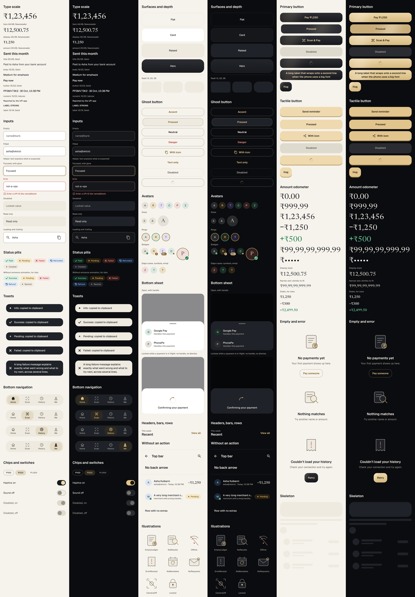

# PayFlow design system: Aurum Noir

Code lives in `app/src/main/kotlin/com/darshan/payflow/ui/designsystem/`. The direction and its reasoning are in [`DESIGN_DIRECTION.md`](DESIGN_DIRECTION.md).

Rendered on the JVM from the debug-only catalog: the current `ds_*` screenshot baselines, light and dark side by side. The per-component baselines are in `app/src/test/screenshots/`.

## Rules for screens
- Use only these tokens and components: no raw hex, `dp`, `sp`, durations or easing in screen code. `scripts/token_audit.py` and `TokenAuditTest` check this; a deliberate exception carries `// token-audit: allow (reason)`.
- One primary action per screen.
- Anything touched or dragged moves on a spring. No linear easing on UI motion.
- Read animated values in `graphicsLayer` or `drawBehind`, not in composition.
- Delight (sheen sweeps, confetti, stamps) is for real achievements only.
- `MotionToken` decides what happens under reduced motion. A flow must never depend on an animation finishing.

## Tokens
Theme-dependent values are read from `PayFlowTheme`; static ones are plain objects, also reachable through `PayFlowTokens`.

| Token | Read with | Values |
|---|---|---|
| Colour | `PayFlowTheme.colors` | `bg`, `surface`, `raised`, `text`, `textSecondary`, `primary`/`onPrimary` (+`primaryTop`, `primaryBottom`, `primaryPressed`, `primaryDisabled`, `onPrimaryDisabled`), `accent`, `accentTint`/`onAccentTint`, `hairline`, `outline`, `focusGlow`, `scrim`, `tactileCap`/`onTactile`/`tactileBase`, `toast`/`onToast`, `heroStart`/`heroEnd`/`onHero`, `success`/`pending`/`failed`/`refund`/`neutral` (each `strong`, `content`, `container`), `shimmerBase`/`shimmerHighlight`, `sheen`, `avatarTones` |
| Type | `PayFlowTheme.type` | `hero` 44/48, `display` 30/36, `amount` 20/26 (Newsreader); `title` 20/26, `body`, `bodyStrong`, `button`, `numeric` 15/22, `label`, `labelStrong` 12/16 (Geist) |
| Spacing | `Spacing` | `xxs` 4, `xs` 8, `sm` 12, `md` 16, `lg` 20, `xl` 24, `xxl` 32, `xxxl` 48, `huge` 64, `screen` 20 |
| Radius | `Radii` | `small` 12, `medium` 20, `large` 28, each with a shape, plus `topLargeShape`, `bottomLargeShape` and `pillShape` |
| Depth | `Hairline`, `SurfaceLevel` | 1dp hairline over layered tones. No drop shadows |
| Sizes | `Sizes` | `touchTarget` 48, `buttonHeight` 56, icons 16/24/32, avatars 32/40/56/64, `quickAction` 56, `heroAction` 88 and other fixed sizes |

`strong` is for status text on `bg` or `surface`; `content` on `container` is the tinted pill. Every text pair is at least 4.5:1 and every control boundary at least 3:1, enforced by `TokensTest`.

Newsreader's digits are tabular by default. Signs in amounts always come from Geist, because Newsreader's minus sits too low.

`PayFlowTheme` also maps these onto Material slots, so screens still using Material components get the look until they are rebuilt.

## Motion
Read with `PayFlowTheme.motion` or `LocalMotion`.

| `MotionToken` | Role | Full motion | Reduced motion |
|---|---|---|---|
| `Press` | Feedback | Snappy 1200/1.0 | 90ms tween |
| `Release` | Feedback | Bouncy 420/0.72 | 90ms tween |
| `Snap` | Essential | Snappy | 150ms fade |
| `Bounce` | Essential | Bouncy | 150ms fade |
| `Settle` | Essential | Gentle 160/0.95 | 150ms fade |
| `Micro`, `Small` | Essential | 120ms, 240ms emphasized | 150ms fade |
| `Screen`, `ScreenExit` | Essential | 420ms decelerate, 200ms accelerate | 150ms fade |
| `Shake` | Essential | 420ms | 150ms fade (inputs skip the shake and keep colour, icon and text) |
| `Ambient`, `Shimmer`, `Sheen` | Decorative | 2400ms, 1400ms, 900ms | Off |

- Duration bands: micro 90 to 150ms, small 200 to 300ms, screen 350 to 500ms. Stagger is 40ms per item, capped at 320ms. A sequence that plays one item at a time steps every 280ms (`MotionDurations.SequenceStep`).
- Motion is reduced when the in-app setting is on or the system animator scale is 0 (`resolveMotionLevel`).
- Helpers: `motion.spec<T>(token)`, `motion.enter()`, `motion.exit()`, `motion.popIn()`, `motion.sharedAxisX(forward)`, `motion.fadeThrough()`, `motion.staggerDelayMs(index)`, `motion.decorativeEnabled`.

## Effects and settings
| Piece | Use |
|---|---|
| `LocalHaptics` / `PayFlowTheme.haptics` | `tick` for detents, `light` for presses (buttons do this themselves), `confirm` for real success, `reject` for refusals, `heavy` for a weighty commit. Plays through the view's haptic channel, so it needs no permission and respects the phone's touch-feedback setting |
| `LocalUiSound` | `play(UiSoundEvent)`. Off by default and silent for now |
| `UiEffectChannel`, `CollectUiEffects` | One-off effects. A ViewModel calls `effects.send(UiEffect.Haptic(HapticEvent.Confirm))` and exposes `effects.effects`; the screen collects it. Feature effects such as navigation implement `UiEffect` and arrive through `onOther` |
| `UiPreferences` | `settings: StateFlow<UiSettings>` (haptics on, sound off, reduce motion off, theme system, amounts shown), `loaded`, and suspend setters. Injected by Hilt; read by `MainActivity`. `InMemoryUiPreferences` is for tests |

Tests use `FakeHaptics` and `FakeUiSound` (`app/src/test/.../ui/designsystem/FakeEffects.kt`) through `PayFlowTheme(haptics = fake)` or the `setDs` helper.

## Components
All in `ui/designsystem/components/` unless noted.

| Component | File | States and notes |
|---|---|---|
| `PrimaryButton` | `Buttons.kt` | Enabled, pressed, disabled, loading. Brushed-metal sheen, 500ms debounce, one light haptic per accepted click |
| `TactileButton` | `Buttons.kt` | Same states. The cap travels 4dp onto its base when pressed |
| `GhostButton` | `Buttons.kt` | Same states, plus `outlined` and `tone` (accent, neutral, danger) |
| `PayFlowIconButton` | `Buttons.kt` | 48dp target, `tonal`, required `contentDescription` |
| `BrandLoader` | `BrandLoader.kt` | Replaces every stock spinner. Holds still under reduced motion |
| `PayFlowTextField` | `Inputs.kt` | Empty, filled, focused glow, error with shake and reject haptic, disabled, read-only, helper, leading and trailing slots |
| `AmountOdometer`, `AmountText` | `AmountOdometer.kt` | Rolling or static amount, Indian grouping up to ₹99,99,99,999.99, Geist sign, auto-shrink (measured at each step, so every digit fits at any text size), `hidden` on both. Rules in `OdometerLogic.kt` |
| `PayFlowAvatar` | `Avatar.kt` | Tone from name, `ring`, `badge` (verified, count, dot) |
| `StatusPill`, `DrawnCheckmark`, `DrawnCross` | `StatusPill.kt` | Success draws a check, failed a cross with a small shake, refund's arrow turns backwards, pending breathes. Set `animate = false` in lists |
| `PayFlowBottomSheet` | `BottomSheet.kt` | Spring entrance, drag with fling, works from inside scrollable content, `dismissible = false` locks it. Drawn in the screen's own window so `FLAG_SECURE` still covers it |
| `SkeletonBlock`, `SkeletonLine`, `SkeletonCircle`, `SkeletonRow`, `SkeletonList`, `SkeletonGroup` | `Skeleton.kt` | One shared shimmer per group. `SkeletonBlock` takes `base` and `highlight` for surfaces the default tones don't suit, such as the graphite hero |
| `PayFlowToastHost`, `PayFlowToast`, `rememberToastHostState` | `Toast.kt` | Info, success, pending, failed. Bounded queue, repeats collapse, tap to dismiss |
| `EmptyState`, `ErrorState`, `Illustration` | `StateViews.kt`, `Illustrations.kt` | Eight code-drawn drawings: `EmptyLedger`, `NoResults`, `Offline`, `ErrorReceipt`, `NoMandates`, `NoRequests`, `CameraOff`, `Locked`. An empty state that is only empty because of a filter or search offers the way back as its action |
| `PayFlowBottomNav`, `rememberBottomNavState`, `NavGlyphs` | `BottomNav.kt` | Floating dock, sliding pill, morphing icons. Rules in `BottomNavLogic` |
| `SectionHeader`, `PayFlowTopBar`, `PayFlowListRow`, `PayFlowSurface`, `HairlineDivider` | `Surfaces.kt` | Structure and depth. `SurfaceLevel`: flat, card, raised, hero. `PayFlowListRow(subtitleMaxLines)`: 1 for record lists, more for settings rows whose subtitle explains something |
| `PayFlowChoiceChip`, `PayFlowSwitch` | `Selection.kt` | Filter and quick-amount chips, settings toggles |
| `PayFlowSearchField` | `SearchField.kt` | Pill search for a header: glyph, text, close button with the owner's meaning, focus glow, no label |

Modifiers in `ui/designsystem/modifiers/`:

| Modifier or helper | Notes |
|---|---|
| `Modifier.metallicSheen`, `rememberSheenSweep` | AGSL on API 33+, moving gradient below. Position is read in draw |
| `Modifier.filmGrain` | AGSL on API 33+, tiled noise bitmap below. Static. Use on hero surfaces, not across scrolling lists |
| `rememberPressFeedback`, `Modifier.trackPress`, `Modifier.pressScale` | Press state from raw pointer events: starts on the next frame, even inside scrollers |
| `StaggeredEntrance` | Fade and rise with the stagger token |

## Catalog
`DesignCatalog` shows every component in every state, with switches for theme and reduced motion and a live area for touch and motion. It lives in `src/debug`, so nothing reaches a release build.

    adb -s emulator-5554 shell am start -n com.darshan.payflow/.ui.designsystem.catalog.DesignCatalogActivity

## Screenshot tests
`./gradlew recordRoborazziDebug` writes baselines and `./gradlew verifyRoborazziDebug` compares against them. They run on the JVM with no device.

- `DesignCatalogScreenshotTest` (`src/testDebug`): every catalog section in light and dark, some at 1.3× font scale. Adding a section to `CatalogSections` and a test line covers a new component.
- `MotionScreenshotTest`: frozen frames from the middle of animations.
- Roborazzi's default compare threshold passes changes under 1 % of the pixels, so after an intended change to a small element (a label colour, a badge), re-record the classes that show it rather than relying on verification to fail.

## Adding to the system
1. Put pure rules in a plain class and test them on the JVM.
2. Build the component from tokens, reading animated values in the draw or layer phase.
3. Add it to the catalog in every state, in both themes.
4. Test it with `mainClock.autoAdvance = false` at 1.0× and 1.3×, with reduced motion on and off. Wrap state changes in `commitState { }`: with a paused clock nothing else delivers them to the recomposer, and an animation test would pass without animating.

## Title rule
A tab root (Home's wordmark, History, Me) names itself in the serif `display` face: `PayFlowTopBar(title, large = true)`. Screens pushed on top of it, and sheets, use the sans `title`. Serif is otherwise for money and hero headlines.

## Hero surfaces
`PayFlowSurface(level = SurfaceLevel.Hero)` is graphite in both themes. Its text is `onHero` (ivory in both), and everything placed on it reads `HeroPalette`, the dark palette, so a button, pill or avatar on a hero looks the same in light and dark.

## App shell
Lives outside the design system, built only from it.

| Piece | File | Notes |
|---|---|---|
| `AppGate` | `ui/lock/AppGate.kt` | The only way to the app. Circular reveal on unlock |
| `LockScreen` | `ui/lock/LockScreen.kt` | Spring dots, wrong-PIN shake and pulse, round keypad. Rules in `LockMotionLogic` |
| `ShellLogic`, `ShellTransitions` | `ui/navigation/` | Which transition between two screens, and where the bar shows |
| `Modifier.containerTransform(key)` | `ui/navigation/ShellTransitions.kt` | One end of a container transform. Does nothing under reduced motion or outside the shell |
| `LocalBottomBarInset` | `ui/navigation/ShellBottomBar.kt` | A tab screen keeps this free at the end of its scroll and lifts anything anchored to the bottom by it |
| `ScrollToTopOnReselect(tab, state)` | `ui/navigation/ShellBottomBar.kt` | What a tab screen adds so tapping its tab again scrolls to the top |
| `holdUntilReadyThenHandOff` | `ui/splash/SplashHandoff.kt` | Splash hold and exit. Rules in `SplashPolicy` |

## Home
Lives outside the design system, built only from it. Rules are in `ui/home/HomeLogic.kt`.

| Piece | File | Notes |
|---|---|---|
| `HomeHero`, `HomeHeaderState` | `ui/home/HomeHero.kt` | Full-bleed graphite header that docks into the top bar. Parts move in layers, so a scroll step recomposes nothing. Blocks touches to what's scrolled beneath it |
| `VeiledAmount` | `ui/home/HomeHero.kt` | Hide and show: blur and a random, mask-length scramble, swapping at the peak. Interruptible. Reduced motion keeps a short fade |
| `ScanAndPay` | `ui/home/HomeScreen.kt` | The primary action, across the header's edge in a notch. Breathing ring in a layer, stopped once docked. Container transform into the scanner |
| `magneticPress`, `AvatarRipple`, `PullCoin` | `ui/home/HomeMotion.kt` | Quick action lean, contact tap ring, refresh coin. Reduced motion: scale only, no ring, a still coin |

- Motion: scroll is direct. Hide is `Micro` then `Small`. Stagger is the standard token, once per visit; a new row plays its own. A new total rolls from the last one seen, with one sheen sweep.
- Bottom bar: content fades out in the 24dp above the dock. From the dock's top edge down, the base is solid background.
- A tab screen's end spacer needs the navigation bar inset as well as `LocalBottomBarInset`. Tests don't catch this, because Robolectric reports no inset.

## Pay and Scan
Live outside the design system, built only from it. Rules are plain classes in `ui/pay/PayLogic.kt`, `ui/pay/SwipeToPayHolder.kt`, `ui/pay/ReceiptContent.kt` and `ui/scan/ViewfinderMotion.kt`.

| Piece | File | Notes |
|---|---|---|
| `SwipeToPay` | `ui/pay/SwipeToPay.kt` | Commits on lift past 90 %, detent ticks, spring home, TalkBack activate opens a confirmation |
| `AmountKeypad` | `ui/pay/PayForm.kt` | Refuses keys that would make the amount invalid; the amount is an `AmountOdometer` |
| `ResultView`, `PrintingReceipt` | `ui/pay/PayOutcomeViews.kt` | One outcome per record (`PayOutcomes`); receipt prints on the Settle spring, readable from its first frame |
| `CoinBurst`, glyphs, `ProcessingRing` | `ui/pay/OutcomeGlyphs.kt` | Burst only for a provider-confirmed success; nothing composed under reduced motion |
| `ReceiptImage`, `ReceiptExporter` | `ui/pay/ReceiptImage.kt` | Off-screen image from `ReceiptContent`, one file in `cache/receipts/` |
| `Viewfinder` | `ui/scan/ScanScreen.kt` | Breathing brackets and AGSL beam, read in draw |

New size tokens: `Sizes.swipeTrack`, `swipeHandle`, `keypadKey`, `keypadDockMinHeight`, `viewfinder`, `viewfinderBracket`, `receiptPerforation`.

## Money screens
Live outside the design system, built only from it. Rules are plain classes in `ui/history/HistoryLogic.kt`, `ui/history/ScratchLogic.kt`, `ui/collect/CollectLogic.kt` and `ui/mandates/MandateLogic.kt`.

| Piece | File | Notes |
|---|---|---|
| `PaymentFeedRow` | `ui/components/PaymentFeedRow.kt` | The payment row everywhere: Home, History, a mandate's debits. Hide-aware, one TalkBack sentence, one end of the container transform |
| History | `ui/history/HistoryScreen.kt` | Sticky day headers with what was sent, search that grows from its button, swipe tray (`RowSwipeHolder`) with TalkBack actions |
| Payment sheet | `ui/history/PaymentDetailScreen.kt` | A destination drawn as a sheet; the row grows into it; drag down to close. Pay's `ReceiptCard` inside |
| Collect requests | `ui/collect/CollectScreen.kt` | Heads-up entrance, countdown ring, `SwipeToPay` to pay, review sheet, one-tap decline |
| AutoPay | `ui/mandates/MandateScreens.kt` | Card stack (`CardStackHolder`), pause/resume morph (`PauseResumeGlyph`), expected-debit timeline (`MandateSchedule`) |
| `ScratchCard` | `ui/history/ScratchCard.kt` | Demo cashback: offscreen foil cleared under the finger, reveal at 55 %, ring of glints. Only after a provider-confirmed payment |

- Motion: search reveal and row tray on Snap; heads-up and stack rise on Bouncy, with the stagger token; countdown sweep on Small between one-second ticks; pause/resume morph on Bouncy; foil fade on Small, glints on Screen and off under reduced motion.
- New size tokens: `Sizes.rowSwipeAction`, `countdownRing`, `ringStroke`, `mandateCard`, `mandateStackPeek`, `timelineDot`, `scratchCard`, `scratchBrush`.

## Settings and security
Live outside the design system, built only from it. Rules are plain classes in `ui/security/SecurityLogic.kt` and `ui/security/TamperWarning.kt` (`TamperWarningLogic`).

| Piece | File | Notes |
|---|---|---|
| Security centre | `ui/security/SecurityScreen.kt` | Five checks tick in sequence (`CheckReveal`, 280 ms apart on the frame clock), each from the real security layer (`SecurityChecks`). Pass, failure, attention and note glyphs draw once, in the draw phase. One next step as the primary action; each row opens its sheet |
| Turn off app lock | `ui/security/SecurityScreen.kt` | In-window sheet; needs the current PIN or a biometric |
| `TamperWarning`, `TamperWarningOverlay` | `ui/security/TamperWarning.kt` | Full-screen explanation of a payment-guard block. No way to pay from it |
| Me | `ui/me/MeScreen.kt` | Profile card, Security and Receive rows, toggles for haptics, sound, reduce motion and theme, About sheet |
| Receive | `ui/receive/ReceiveScreen.kt` | Graphite card, QR on white paper (`Sizes.qrCode`), share image as the primary action |
| Checkout | `ui/checkout/CheckoutScreen.kt` | `CheckoutKitTheme` passes tokens to CheckoutKit's sheet through Material slots; the store recedes on the Settle spring while it's up |
| `ChimeSynth`, `ChimeUiSound` | `ui/designsystem/effects/ChimeSound.kt` | The optional success chime, synthesised in code, off by default |
| `SensitiveClip`, `copySensitive` | `ui/components/SensitiveClipboard.kt` | Clipboard copies flagged sensitive |

- Motion: ticks on Small, one per 280 ms step; radio fill on Bounce; store recede on Settle; Receive's card pops in once. Reduced motion: final states at once, no recede, a short fade for the card.
